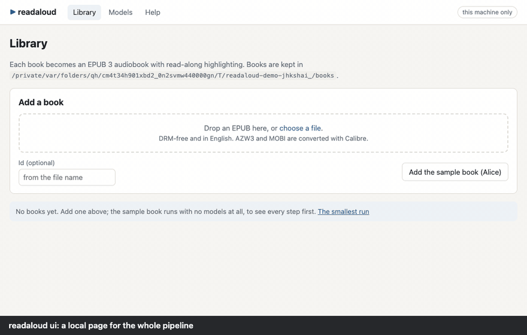
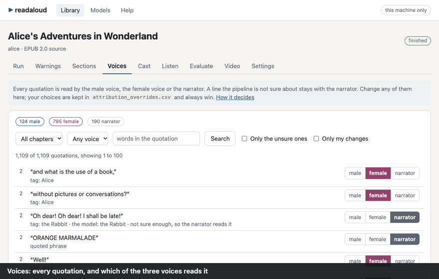
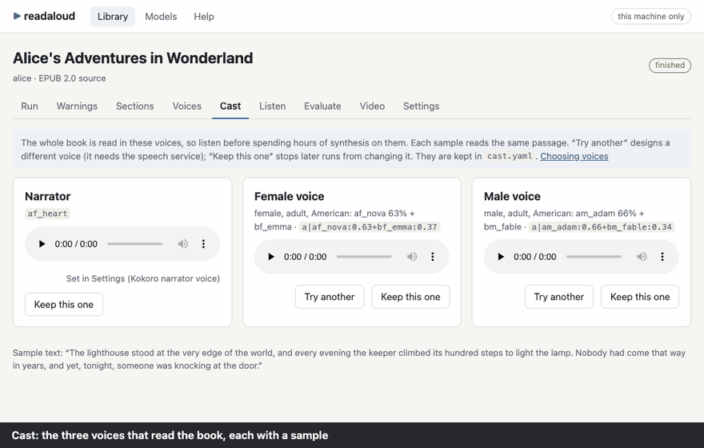
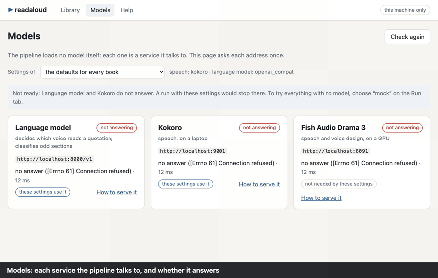

# Using readaloud, step by step

`readaloud` turns one EPUB into one EPUB 3 audiobook with read-along highlighting. This page goes from the
smallest thing that works to a whole novel with three voices. What each stage does and why is in
[DESIGN.md](DESIGN.md); how to serve the models is in [MODELS.md](MODELS.md).

Every step below can also be done in a browser: `readaloud ui` ([step 10](#10-the-same-in-a-browser)).

## 0. Install

You need Python 3.12 or newer, `ffmpeg` on the PATH, and optionally `epubcheck` (the result is checked with it
when it is installed).

```bash
git clone <this repository> && cd epub-readaloud
python3 -m venv .venv && source .venv/bin/activate
pip install -e ".[dev]"
python -m pytest -q          # optional: about three minutes, everything should pass
```

macOS: `brew install ffmpeg epubcheck`. Kindle files (AZW3, MOBI) also need Calibre
(`brew install --cask calibre`); they are converted to EPUB once, when the book is added.

The book must be DRM-free and in English.

## 1. The smallest run: no models

This checks the installation. The "voice" is a placeholder tone and no language model is called.

```bash
readaloud init tests/fixtures/alice_epub2.epub --id alice
readaloud run alice --tts mock --llm mock
```

It ends with something like:

```
package: out/alice-s-adventures-in-wonderland.epub  (13 chapters with audio, 2:09:31.854, 53.8 MB)
package: epubcheck passed, no new errors
```

Everything about a book lives in `books/<id>/`: the source, a SQLite database with every intermediate result,
the generated audio, and `out/<title>.epub`. `readaloud status alice` shows where each chapter is.

Every command can be run again. Work that is already done is skipped, so after an interruption you run the same
command and it carries on.

## 2. A real voice on a laptop: Kokoro, one narrator

```bash
pip install -e ".[kokoro]"
python services/kokoro/server.py --port 9001 &          # the speech service; leave it running
readaloud init path/to/book.epub --id mybook
printf 'multi_voice: false\n' > books/mybook/config.yaml   # one narrator, no language model needed
readaloud run mybook --tts kokoro
```

Try one chapter before the whole book: `readaloud status mybook` lists the documents with their numbers, and
`readaloud run mybook --tts kokoro --docs 3` does only document 3.

`books/<id>/config.yaml` overrides the repository's `config.yaml` key by key; that file lists every setting
with a comment.

## 3. Three voices: add a language model

With a language model the dialogue is split between a male voice, a female voice and the narrator. Anything the
pipeline is not sure about stays with the narrator.

Start an OpenAI-compatible server on `localhost:8000` ([MODELS.md](MODELS.md)), then:

```bash
readaloud init path/to/book.epub --id mybook
readaloud run mybook --tts kokoro
```

The stages, in order:

| Stage | What it does | Needs |
|---|---|---|
| `ingest` | unpacks the book; EPUB 2 is upgraded to EPUB 3 | |
| `segment` | wraps every sentence in a span and checks that the displayed text did not change | |
| `classify` | decides which sections are story and which are not read (contents, captions, licence text) | language model for the unclear ones |
| `cast` | makes the narrator, male and female voices | speech service |
| `voices` | gives every quotation one of the three voices | language model |
| `synth` | generates the audio, one take per piece of text | speech service |
| `assemble` | joins the takes into one audio file per chapter, with the timing of every sentence | |
| `package` | writes the EPUB 3 with Media Overlays and runs epubcheck | |

`readaloud run mybook --until segment` stops after a stage; `--stages cast,synth` runs only those. The cast
stage comes before voices and needs the speech service, so the text-only half of a run is
`--stages ingest,segment,classify,voices`.

To hear one chapter before the whole book, limit the audio, not the text. `--docs` limits every stage it is given
to, and the voices stage then decides that chapter's voices from that chapter alone: names and their genders are
learnt across the book, and on the first chapter of the sample book 13 of 39 quotations lost their voice that way.
So run the text stages for the whole book, then the audio stages for the chapter:

```bash
readaloud run mybook --tts kokoro --until voices
readaloud run mybook --tts kokoro --stages synth,assemble,package --docs 3
```

### Looking at what it decided, and changing it

| File in `books/<id>/` | What it holds | How to change it |
|---|---|---|
| `sections.yaml` | which sections are story, front matter, contents, boilerplate | `readaloud sections <id>` lists them; `readaloud sections <id> --set SECTION=CATEGORY`. For single lines inside a section, add `skip: [sentence ids]` to the file (see below) |
| `genders.yaml` | the gender the pipeline worked out for each name and description | add entries under `manual:`; they win |
| `attribution_overrides.csv` | your own voice for a quotation: `quote_id,speaker,style,note` with speaker `male`, `female` or `narrator` | edit the file, then `readaloud run <id> --stages voices` |
| `cast.yaml` (Kokoro) or `cast.drama3.yaml` | the three voices | `readaloud cast <id>` lists them; `--play ID`, `--reseed ID`, `--freeze ID` |

Files you edit always win over what the models say, and they are never overwritten.

A section can only be set as a whole. To keep single lines from being read (a printer's imprint after the last
line of a novel, a stray credit), list their sentence ids under `skip:` in `sections.yaml` and run the classify
stage again. Take the ids from the database, not from the ranges that `readaloud sections` prints: those ranges
count from 0 within a file, while the number in an id counts from 1.

```bash
sqlite3 books/mybook/project.db "select id, substr(text,1,60) from sentence where doc_id=16 order by seq desc limit 5"
printf 'skip: [ab016s00172, ab016s00173]\n' >> books/mybook/sections.yaml
readaloud run mybook --stages classify
```

`readaloud review <id>` lists the attributions most worth a human look. After changing voices or attributions,
run the book again: only the affected lines are generated again.

## 4. The best voices: Drama 3

Drama 3 needs a GPU machine ([MODELS.md](MODELS.md)). On the machine where this was developed the language model
and Drama 3 did not fit in memory together, so a book is done in two halves:

```bash
# language model up
readaloud run mybook --stages ingest,segment,classify,voices

# stop the language model, start Drama 3 (scripts/drama3_serve.sh)
readaloud run mybook --tts drama3
```

The cast stage designs three voices by asking Drama 3 to read a passage of the book with no reference voice and
keeping candidates by pitch. Listen before spending hours of synthesis on them:

```bash
readaloud run mybook --tts drama3 --stages cast
readaloud cast mybook --play narrator        # also: _generic_male, _generic_female
readaloud cast mybook --reseed _generic_male # try another one
readaloud cast mybook --freeze narrator      # keep this one whatever changes later
```

To use the same three voices for several books, copy `cast.drama3.yaml` and the `voices/` folder from the first
book's directory into the next one before running its cast stage.

A line that Drama 3 cannot read (it "runs away" on every seed) stops the run before assembly, so that a broken
line is not packaged silently. For an unattended run set `tts: {drama3: {on_runaway: cut}}`: the line is cut
short, listed in `reports/synth_flagged.tsv`, and the book finishes. `readaloud regen <id> --flagged` drops
those takes so that the next run tries them again. A line on its own comes out the same for the same seed, so
add `--next-seed` to move it on to seeds not tried yet (kept in `books/<id>/reseed.yaml`). The same works for
any line you heard go wrong: `readaloud regen <id> ab063s00061u0 --next-seed`, then run the book again; only
that line and its chapter are redone.

For a whole book, run `readaloud` on the GPU machine. `scripts/run_bg.sh <id> [run options]` starts it detached
from the terminal and appends to `books/<id>/run.log`.

## 5. Reading it

Open `books/<id>/out/<title>.epub` in a reader that supports EPUB 3 Media Overlays. Development was done against
[Readest](https://readest.com); the audio is AAC in one m4a file per chapter because that stayed in sync there on
every device tried, and Opus did not.

`mo_test_epub.py` builds small test books (sentence- and word-level highlighting in several audio formats) and a
checklist, for trying another reader.

## 6. When it stops

`readaloud run` exits with code 3 when it pauses on a warning. `readaloud warnings <id>` lists what is open.

| Warning | Meaning | What to do |
|---|---|---|
| `SECTION_UNCERTAIN` | the pipeline could not tell whether a section is story | look with `readaloud sections <id>`, set it, run again |
| `LLM_FAILED` | one chunk's request failed or was cut off; it is retried at the end of the run | run again; nothing else is lost |
| `LLM_DOWN` | several chunks in a row failed | check that the language model server answers, then run again |
| `TRUNCATED` | a model answer hit the length limit | usually handled by splitting the chunk; if it repeats, raise `llm.max_tokens` |
| `REPEATED` | the same warning keeps coming back | something systematic; read the earlier warnings |

Acknowledge one with `readaloud warnings <id> --ack ID --note "..."`, or resolve it with `--resolve`. For a
measurement run that should not stop, set `monitor: {no_pause: true}`.

Other messages:

| Message | Cause |
|---|---|
| `LLM not reachable at http://localhost:8000/v1` | the language model server is not up, or the tunnel to it is closed |
| `Drama 3 service ... not answering` | the same, for port 8091 |
| `DisplayMismatch: ...` | segmentation would have changed the text a reader sees; the run stops rather than produce a book that differs from the source. Please report the book's structure |
| epubcheck errors | only errors that the source book does not already have count; the report is in `books/<id>/reports/` |

## 7. Measuring it on a book with known speakers

The [Project Dialogism Novel Corpus](https://github.com/Priya22/project-dialogism-novel-corpus) (PDNC, CC-BY 4.0)
labels the speaker of every quotation in a set of novels. It is used here only to score results.

```bash
scripts/fetch_pdnc.sh PrideAndPrejudice                        # into data/pdnc/ (not part of this repository)
readaloud init tests/fixtures/pride_epub2.epub --id pride
readaloud run pride --stages ingest,segment,classify,voices
readaloud eval pride --pdnc data/pdnc/PrideAndPrejudice --tag first
readaloud eval-compare pride:first pride:second                # two runs side by side, with every quote that changed
```

The report (`books/pride/reports/eval/first.md`) gives the share of quotations read in the wrong gender, the
share given a male or female voice at all, and the list of misses. The edition must match PDNC's text closely;
the report says how many quotations lined up. Compare two settings only within one session of the language
model server: its answers differ from one start to the next ([DESIGN.md](DESIGN.md)).

## 8. A corrected edition

For a book that PDNC covers, the known speakers can be written into the book's own corrections file, so that
every quotation that lines up is read in the right voice:

```bash
readaloud run pride --stages ingest,segment,classify,voices
python scripts/pdnc_overrides.py pride --pdnc data/pdnc/PrideAndPrejudice
readaloud run pride --stages voices          # applies the corrections; no model calls
readaloud eval pride --pdnc data/pdnc/PrideAndPrejudice --tag corrected
```

This is a different thing from the pipeline's own result, and an audiobook made this way should say so and credit
PDNC. Rows you wrote yourself in `attribution_overrides.csv` are kept and still win.

## 9. A video with chapters and captions

A finished book can be turned into video files: the cover as a still picture over the audio, a description with
chapter timestamps, and one caption per sentence taken from the book's own timing.

```bash
python scripts/youtube_export.py mybook --edition "Project Gutenberg ebook #1342" --repo-url https://github.com/you/epub-readaloud
# -> books/mybook/out/youtube/: <title>-part1.mp4, .srt, .txt (description), <title>-thumbnail.jpg
```

A book longer than `--max-hours` (default 11.5) is cut into parts at chapter headings, as evenly as the headings
allow; `--parts 3` asks for a number of parts. To cut where the book's own volumes begin, name the heading each
later part starts at:

```bash
python scripts/youtube_export.py pride --cut "CHAPTER XXIV." --cut "CHAPTER XLIII." --part-name Volume
```

`--no-video` writes the captions, descriptions and picture only, which is also the quick way to see where the
cuts fall before encoding.
Nothing is uploaded. Before publishing, check the book's copyright in the countries where the video will be
shown and the licence of the speech model, and say that the voices are synthetic.

## 10. The same in a browser

```bash
readaloud ui                      # opens http://localhost:8765
readaloud ui --port 9000 --no-browser
readaloud --books /some/dir ui    # another books folder
```

It is a page served by a small program on your machine. It listens on this machine only, needs nothing installed
beyond the pipeline, and uploads nothing. On a GPU machine, start it there and forward the port
(`ssh -N -L 8765:localhost:8765 user@gpu-host`), then open the same address on your laptop.



**Library.** Drop an EPUB (or AZW3, MOBI) to add it; "Add the sample book" adds Alice, which runs with no model.

**Run.** The stages and where the book stands; choose the speech and language models, how far to go, and
optionally the chapters to make audio for; Start, Stop, and the same button again to carry on. The log is the
job's own output. A job keeps running when the page, or `readaloud ui` itself, is closed. "Audio for chapters"
limits the audio only: the text stages always cover the whole book, for the reason given in step 3.

**Warnings.** What stopped a run, what it means, and what to do; acknowledge or resolve it there.



**Sections, Voices.** What was decided and by what. Change a section's category, untick a single line so that it
is not read, give a quotation another voice, or settle a name's gender once for the whole book. "Apply" runs the
voices stage again; answers the model already gave are reused.



**Cast, Listen.** Play each voice's sample, design another, or keep one. Play a chapter with the sentence being
read marked, or a single sentence; "Again" and "Differently" make one sentence's audio again (`readaloud regen`,
the second with `--next-seed`) and put its chapter together.



**Evaluate, Video, Settings, Models.** Score a book against known speakers and compare two results (steps 7 and
8); make video files, with the parts shown before anything is encoded (step 9); edit the book's `config.yaml` as a
form in which every setting is explained; and see whether each model service answers at the address in the
settings. **Help** is these documents.

| In the page | The file it writes, or the command it runs |
|---|---|
| a section's category; a line that is not read | `sections.yaml` |
| a quotation's voice | `attribution_overrides.csv` |
| a name's gender | `genders.yaml`, under `manual:` |
| the three voices | `cast.yaml` or `cast.drama3.yaml`, through `readaloud cast` |
| settings | the book's `config.yaml`, only what differs from the defaults |
| Start, Apply, Again, Make the files | `readaloud run`, `readaloud regen`, `scripts/youtube_export.py`, shown in the log |

To let another machine on your network use it, `readaloud ui --host 0.0.0.0`; anyone who can reach that address
can then run jobs and read the books, so do that only on a network you trust.

The UI's tests run with the rest (`python -m pytest`). The ones that drive a real browser need Playwright
(`pip install -e ".[browser]"`; it uses the installed Chrome, or `playwright install chromium`) and are skipped
without it. `python scripts/ui_demo.py` runs the same scenarios and records the pictures on this page.
